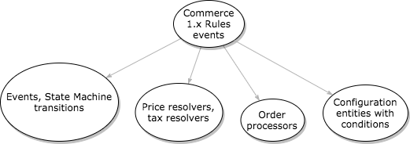

This section helps developers who know Commerce 1.x on Drupal 7 bridge the gap to Commerce 2.x and 3.x on modern Drupal.

## Understanding modern Drupal

Drupal 8 and later are built on Symfony components and object-oriented code: services and dependency injection, plugins, event subscribers, and configuration management in YAML. Commerce relies on all of them. Rather than repeating existing documentation, start with:

- [Services and dependency injection](https://www.drupal.org/docs/drupal-apis/services-and-dependency-injection)
- [Plugin API](https://www.drupal.org/docs/drupal-apis/plugin-api/plugin-api-overview)
- [Subscribe to and dispatch events](https://www.drupal.org/docs/develop/creating-modules/subscribe-to-and-dispatch-events)
- [Configuration management](https://www.drupal.org/docs/administering-a-drupal-site/configuration-management)

## Product information structure

Commerce 1.x stored products as product entities displayed through nodes ("product displays"). There are no more nodes: Commerce now has **products**, which hold the shared information and are displayed directly, and **product variations**, which are the purchasable SKUs. A 1.x product corresponds to a variation, and a 1.x product display node to a product. Variations are edited from their product.

Product attributes are their own entity type (`commerce_product_attribute_value`), instead of taxonomy terms. See [Product information structure](products/product-information-structure.md).

## Taxes and VAT

Tax support is in Commerce Core, with built-in tax types for EU, UK, Swiss and Norwegian VAT and Canadian sales tax, and custom tax types. It replaces the various VAT contributed modules of 1.x. See [Taxes](../user-guide/taxes.md).

## Shipping

[Commerce Shipping](https://www.drupal.org/project/commerce_shipping) brings together what took several contributed modules in 1.x. It includes flat rate shipping methods, and handles shipments, packaging into package types, and fulfillment, while carrier modules provide live rates. See [Shipping](../user-guide/shipping.md).

## Discounts and coupons

Discounts and coupons are in Commerce Core, as **promotions**: each promotion has an offer, conditions and optional coupons. They replace the Commerce Discount and Commerce Coupon modules of 1.x. See [Promotions](promotions/getting-started.md).

## Price calculation

The base price of a product variation is the price without adjustments (i.e. without promotions, taxes, etc...). Price
resolving is the process of finding the base price of the variation. Price resolvers are services. The default price
resolver simply returns the price in the variation's price field.

To actually resolve a price, commerce uses the `commerce_price.chain_price_resolver` service which finds all price
resolver services and calls their `resolve()` method until one of them returns a price. For example, to support multiple
currencies one could implement a custom price resolver service fetching the price with the appropriate currency from a
multivalue price field.

Price resolvers do not know about the order the product has been added to. Enter order processors.

[Order refresh](../orders/getting-started/#order-refresh-and-processing) runs order processors to (among others) add
adjustments (e.g. promotions, taxes) to the order. An adjustment can rely on order data when changing the price.

The `commerce_order.price_calculator` service can be used to find out the variation price including adjustments. It is
used by the `commerce_price_calculated` field formatter implemented in the `commerce_order` module. It works by creating
an unsaved order and applying adjustments on it.

## Commerce without Rules

Commerce 2.x no longer relies on the Rules module. We now have event subscribers (example: order state changes),
resolvers (example: calculating sell price and calculating VAT), and entities configured with conditions (example:
payment gateways).

Be aware that some events correspond to state transitions, and
the [State Machine](https://drupal.org/project/state_machine) module fires them upon a transition. You can find the
metadata for these in `MODULENAME.workflows.yml`. Events are also documented in the `\Drupal\MODULENAME\Event` namespace
as a final class containing constants. For an example of using these, see
`\Drupal\commerce_log\EventSubscriber\OrderEventSubscriber::getSubscribedEvents()`.

<h3>Partial list of where the Rules went</h3>

| Commerce 1.x                                            | Commerce 2.x                                                                                                                                                                                                          |
|---------------------------------------------------------|-----------------------------------------------------------------------------------------------------------------------------------------------------------------------------------------------------------------------|
| **Completing the checkout process** Rules event         | `commerce_order.place` **transition**; modules react to this and alter the order as needed                                                                                                                            |
| **When an order is first paid in full** Rules event     | `commerce_order.fulfill` transition (**note: does not correspond 1:1 to Drupal 7, but can be used for many of the same purposes**)                                                                                    |
| **After adding a product to the cart** Rules event      | `commerce_cart.entity.add` **event**                                                                                                                                                                                  |
| **After updating an existing commerce order**           | `commerce_order.commerce_order.update` event                                                                                                                                                                          |
| **Calculating the sell price of a product** event       | Now handled through price resolvers, tax resolvers, and order processors. Search for `tag: commerce_price.price_resolver` in the codebase for examples.                                                               |
| **Select available payment methods for an order** event | Now handled through payment gateway configurations at _Administration » Commerce » Configuration » Payment gateways_. These support various conditions to define when payment gateways should be usable by customers. |

<h3>More on resolvers</h3>

[Understanding Resolvers](../core/understanding_resolvers)

Books and tutorials:

[Drupalize.me](https://drupalize.me/tutorials?taxonomy_versions_tid%5B%5D=1046)