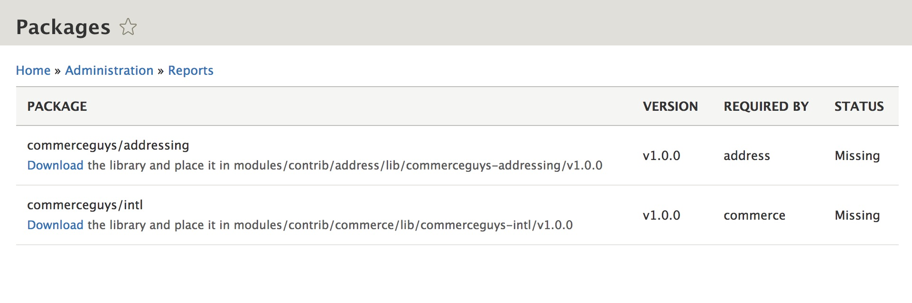
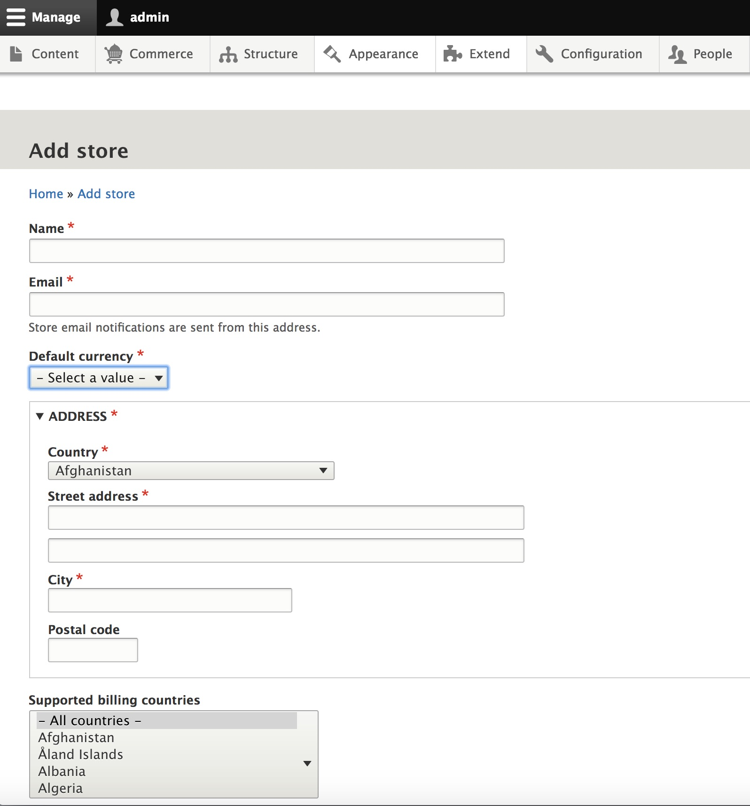
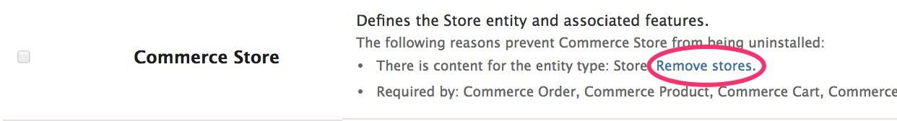
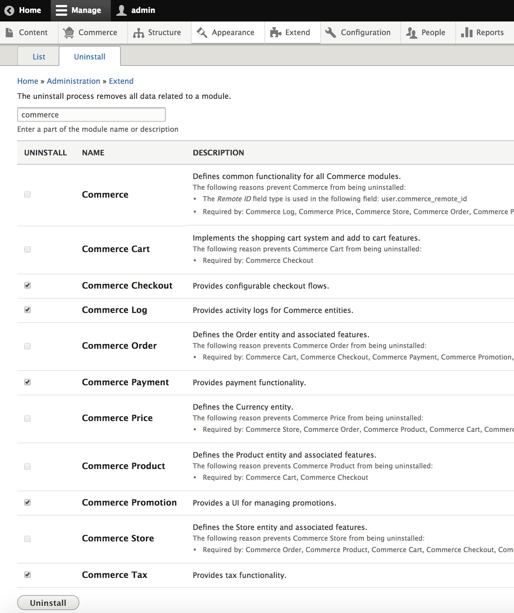

## Before you begin

Drupal Commerce is managed with [Composer](https://www.drupal.org/docs/develop/using-composer/using-composer-with-drupal){target=_blank}. If you are not familiar with it, read [Using Composer with Drupal](./getting-started.md#using-composer) before continuing. We use [Drush](https://www.drush.org/){target=_blank} for site management operations throughout this documentation.

## Requirements

 - Commerce 3.x requires Drupal 10.3 or newer, including Drupal 11. Generally we require the latest minor releases of Drupal core, as they contain improvements that we use.

 - PHP 8.1 or newer, with the [bcmath](https://www.php.net/manual/en/book.bc.php){target=_blank} extension. Your Drupal core version may require a newer PHP version (Drupal 11 requires PHP 8.3), see [Drupal's system requirements]{target=_blank}. The recommended memory limit is 256MB or more.

 - To properly take advantage of [Drupal's configuration management system], you should always develop locally. We recommend [DDEV]{target=_blank}.

 - You will also need [Composer]{target=_blank}. We recommend that you use the newest version of Composer.

## Installation

**Installing Commerce to contribute back?** Check out our [Contributing](./contribute-code.md#preparing-the-local-environment) guide.

Be sure to [review requirements](#requirements) before starting the installation process.

=== "Commerce Kickstart (recommended)"

    [Commerce Kickstart]{target=_blank} is the fastest way to start building on Drupal Commerce.
    It installs Drupal 11, Commerce Core and the [Centarro Certified Projects]{target=_blank}
    (a curated set of Centarro maintained modules and themes). Use it to develop and test
    in a feature-rich environment, or as the starting point for your store.

    ```bash
    composer create-project centarro/commerce-kickstart-project kickstart
    ```

    The installer includes an additional step where you can install a full demo store for evaluation purposes,
    or start building and launch your store right away. The demo is provided by the
    [Commerce Kickstart Demo]{target=_blank} recipe and is not intended for existing sites. If you don't need it:

    ```bash
    cd kickstart
    composer remove drupal/commerce_kickstart_demo
    ```

    See the [Commerce Kickstart project template README]{target=_blank} for more details, and the
    [quick start with DDEV](#quick-start-with-ddev) to get it running locally.

=== "Add Commerce to a Drupal site"

    If you already have a Drupal site, run these commands in its root.
    Starting from scratch? Create a site with the [Drupal recommended project template]{target=_blank} first:

    ```bash
    composer create-project drupal/recommended-project mystore
    cd mystore
    ```

    **Download Commerce**

    This also downloads the required libraries and modules (Address, Entity, State Machine, Inline Entity Form, Profile, Token).

    ```bash
    composer require drupal/commerce
    ```

    **Enable Commerce**

    ```bash
    drush en commerce_product commerce_checkout commerce_cart
    ```

=== "Alternative (Ludwig)"
    !!! warning
        Composer is the recommended way to install and maintain a site. Site administrators using Ludwig need to be careful when combining modules that depend on external libraries, since there are no safeguards against incompatible library versions or overlapping requirements. Updating and maintaining your site will also be more difficult.

    The [Ludwig module]{target=_blank} offers a manual alternative to Composer.
    These instructions assume you are working with an existing site. See the Drupal.org documentation on [Installing Drupal]{target=_blank} if you do not have an existing site.

    1. Download and install the [Ludwig module]{target=_blank}.

    2. Download [Commerce]{target=_blank} and the following required modules. Do not install the modules yet.
        - [Address]{target=_blank}
        - [Entity API]{target=_blank}
        - [Entity Reference Revisions]{target=_blank}
        - [Inline Entity Form]{target=_blank}
        - [Profile]{target=_blank}
        - [State Machine]{target=_blank}
        - [Token]{target=_blank}

    3. Ludwig generates a listing of libraries required by those modules. The Packages page at `admin/reports/packages` provides a download link for each missing library along with the paths where they should be placed.
    

    4. Download the libraries, then clear the cache to make them available. For example, download commerceguys/addressing and place it in the path listed for it under `modules/contrib/address/lib`. You should see the STATUS for each required package change from "Missing" to "Installed". Alternatively, run `drush ludwig-download` to download missing packages.

    5. Install Commerce and the required modules.

    > Whenever Commerce needs to be updated, all modules need to be downloaded again, and then all of their libraries need to be downloaded again as well.

In subsequent sections it is assumed that you are using Composer to manage your site.

### Quick start with DDEV

#### Requirements

 - Install [Composer]{target=_blank}.
 - Install [DDEV]{target=_blank}.

#### Create your project

```bash
composer create-project centarro/commerce-kickstart-project kickstart
cd kickstart
ddev config --project-type=drupal11 --docroot=web
ddev start
```

!!! tip
    If your local PHP version doesn't match the DDEV container, append `--ignore-platform-reqs` to Composer commands run on your machine,
    or run them inside the container instead (`ddev composer ...`).

#### Install Drupal

```bash
ddev launch
```

Follow the installer in your browser. DDEV configures the database connection for you.
Alternatively, install from the command line with `ddev drush site:install`.

#### Getting started

The very first thing you'll want to do to get started with Drupal
Commerce is to create a store (unless you installed the Kickstart demo, which creates one for you).
Under the Commerce menu in the toolbar, navigate to Configuration > Store > Stores and click the `Add store` button.
Once you've created a store, you'll be able to create products and start
developing the rest of your site.



## Updating

!!! warning "Important: You must use Composer to update Drupal Core, Drupal Commerce, and all contributed modules. Otherwise, your site will break. Also, you should always back up your site before starting an update procedure. See [Concept: Data Backups documentation] in the Drupal User Guide for more information."

It is **critically important** that you keep up-to-date with [Drupal security advisories].
You can subscribe to the "Security announcements" newsletter in your [Drupal.org]{target=_blank} user
profile settings.

In order to keep Drupal Commerce and your other installed modules up-to-date,
you can use Composer to produce a list of outdated modules with the Composer
`outdated` command:

```bash
composer outdated --direct
```

Then for each outdated project, you can use the Composer `update` command:

```bash
composer update drupal/token --with-dependencies
```

To update to the newest version of Drupal Commerce:

```bash
composer update drupal/commerce --with-dependencies
```

Please note the `--with-dependencies` option. Without this option
specified, any needed, contributed projects and libraries will not
update. Only the Drupal Commerce module will be updated.

Run your Drupal updates once all the dependencies are updated. We
recommend running them on the command line rather than the
`update.php` script:

```bash
drush updatedb
```

!!! tip "Composer update tips"
    If your `composer update` command isn't working, you can try:

    - Run `composer why-not` to check dependency issues.
    - Run `composer remove` then `composer require` to reinstall the project.
    - Delete the `composer.lock` file and entire /vendor directory from
        your project and then run `composer install`.
    - Run `composer clear-cache`.
    - Run `composer self-update`.

Drupal uses a patch system to provide solutions to issues in between version
releases. If you are unfamiliar with the concept of patching, you can learn
about [Patches]{target=_blank} at drupal.org and check the [Patching](#patching) section below.

## Extending

One of the primary strengths of both Commerce and Drupal is that they are open
source projects. There is a large, active community of developers who
contribute to these and related projects. As a result, you will find that it's
easy to extend Commerce with freely available, "contributed" modules. And if
you can't find something to meet your needs, you can always create your own
modules as well. Contributed modules as well as extensive documentation about
extending your Drupal site can be found on [drupal.org]{target=_blank}. A good place to start
is [Extending Drupal].

For Commerce, you can find everything from modules that provide major types of
functionality to smaller modules that provide unique, specialized functionality.
For example:

* [Commerce Shipping]{target=_blank} makes it possible to ship physical products to your customers.
* [Commerce Recurring]{target=_blank} makes it possible to provide subscriptions and recurring billing.

Extending your composer-managed site with additional modules is a
straightforward process. Each Drupal module has its own project page on
drupal.org with information and instructions. To add a module using composer,
the command is:

```bash
composer require drupal/commerce_shipping
```

Where `commerce_shipping` is the name of the module you want to add to your
project. Composer will add the module as well as all of its dependencies.

Then you can install the module using the Admin UI (`/admin/modules`) or Drush:

```bash
drush en commerce_shipping
```

### Adding custom modules from GitHub

Many Drupal developers use [GitHub]{target=_blank} for their initial module development work. So you may find that a module you'd like to use to extend your site is available on GitHub but not on Drupal.org. So how do you add that custom module to your composer-managed site? You can use [Composer Installers]{target=_blank}, a multi-framework composer library installer. Please see [How to download a module hosted on GitHub via composer.json?]{target=_blank} on Drupal Answers for a good example of how to do this.

If you are developing custom modules locally yourself, see [Managing dependencies for a custom product]{target=_blank} for an explanation of using Composer to manage your dependencies.

## Uninstalling

In order to completely remove Commerce from your Drupal site, you will first
need to delete all existing data. You can do this through the Admin UI using
the `Extend` toolbar item and then clicking on the `Uninstall` tab.

Type 'commerce' into the text box at the top of the page to filter the list by
Commerce modules.

Scan through the list for items that say:
```bash
There is content for the entity type:
```

Click the provided link to permanently remove the content for each entity type.


For example, if you have created a Store for your site, you will see:



Click the `Remove stores` link.


Once all content has been removed, you can start uninstalling the commerce
modules. You will only be able to uninstall a few at a time because of
dependencies. For example, you will not be able to uninstall the base Commerce
module until all other commerce modules are uninstalled. Note: if you have
extended your Drupal Commerce site with any modules that are dependent upon
Commerce, those modules will also need to be uninstalled before you are able
to uninstall Commerce.

Here you can see boxes checked for 5 of the Commerce modules which can be
uninstalled. After clicking the `Uninstall` button, it will be possible to
uninstall additional modules.



Since the Commerce base module provides a field type, it cannot be uninstalled together with the other modules. This is a known Drupal limitation. You will be blocked from uninstalling Commerce and see a "Fields pending deletion" message. You can delete the field in question by running Cron. You can run Cron through the Admin UI by navigating to Configuration > System > Cron.

Once all Commerce modules have been uninstalled, use Composer to remove the
Commerce dependency from your project.

```bash
composer remove drupal/commerce
```

At this point, Commerce and all its data have been uninstalled from your Drupal
site.

## Patching

Drupal uses a patch system to provide solutions to issues in between version
releases. If you are unfamiliar with the concept of patching, you can learn
about [Patches] at drupal.org.

Composer-managed sites apply patches with the [composer-patches]{target=_blank} plugin. Commerce Kickstart includes it; otherwise add it with:

```bash
composer require cweagans/composer-patches
```

Then suppose you want to apply a patch for a Drupal Commerce issue:
[Issue #2901939: Move variations form to its own tab]

1. Copy the link address for the patch you want to apply. In this case, the
link address for the patch is `https://www.drupal.org/files/issues/2018-05-18/commerce-product-variations-tab-2901939-40.patch`

2. Add a "patches" group to the "extra" section of your `composer.json` file:

```json
"extra": {
    "patches": {
        "drupal/commerce": {
            "2901939: Move variations form to its own tab": "https://www.drupal.org/files/issues/2018-05-18/commerce-product-variations-tab-2901939-40.patch"
        }
    }
}
```

Note that "drupal/commerce" is the project name. Then for that project, you
provide the specific patch information. Add one entry per patch, and one group per project.

Once you've made the changes to `composer.json`, you can apply the patch by running:

```bash
composer update drupal/commerce
```

[Patches]: https://www.drupal.org/patch
[Issue #2901939: Move variations form to its own tab]: https://www.drupal.org/project/commerce/issues/2901939
[Applying patches documentation]: https://www.drupal.org/patch/apply
[composer-patches]: https://github.com/cweagans/composer-patches
[Concept: Data Backups documentation]: https://www.drupal.org/docs/user_guide/en/prevent-backups.html
[Drupal's system requirements]: https://www.drupal.org/docs/getting-started/system-requirements
[DDEV]: https://ddev.com/
[Composer]: https://getcomposer.org/doc/00-intro.md
[Drupal's configuration management system]: https://www.drupal.org/docs/administering-a-drupal-site/configuration-management
[Commerce Kickstart]: https://www.drupal.org/project/commerce_kickstart
[Commerce Kickstart Demo]: https://www.drupal.org/project/commerce_kickstart_demo
[Centarro Certified Projects]: https://github.com/centarro/certified-projects
[Commerce Kickstart project template README]: https://github.com/centarro/commerce-kickstart-project
[Drupal recommended project template]: https://www.drupal.org/docs/develop/using-composer/starting-a-site-using-drupal-composer-project-templates
[Ludwig module]: https://www.drupal.org/project/ludwig
[Commerce]: https://www.drupal.org/project/commerce
[Address]: https://www.drupal.org/project/address
[Entity API]: https://www.drupal.org/project/entity
[Entity Reference Revisions]: https://www.drupal.org/project/entity_reference_revisions
[Inline Entity Form]: https://www.drupal.org/project/inline_entity_form
[Profile]: https://www.drupal.org/project/profile
[State Machine]: https://www.drupal.org/project/state_machine
[Token]: https://www.drupal.org/project/token
[Installing Drupal]: https://www.drupal.org/docs/getting-started/installing-drupal
[Drupal security advisories]: https://www.drupal.org/security
[drupal.org]: https://www.drupal.org
[Extending Drupal]: https://www.drupal.org/docs/extending-drupal
[Commerce Shipping]: https://www.drupal.org/project/commerce_shipping
[Commerce Recurring]: https://www.drupal.org/project/commerce_recurring
[GitHub]: https://github.com/
[Composer Installers]: https://github.com/composer/installers
[How to download a module hosted on GitHub via composer.json?]: https://drupal.stackexchange.com/questions/243581/how-to-download-a-module-hosted-on-github-via-composer-json
[Managing dependencies for a custom product]: https://www.drupal.org/docs/develop/using-composer/managing-dependencies-for-a-custom-project
