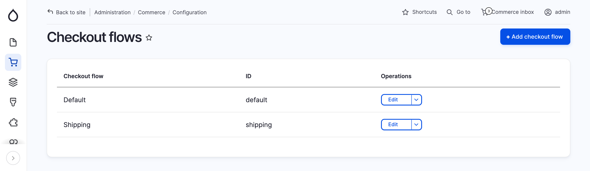
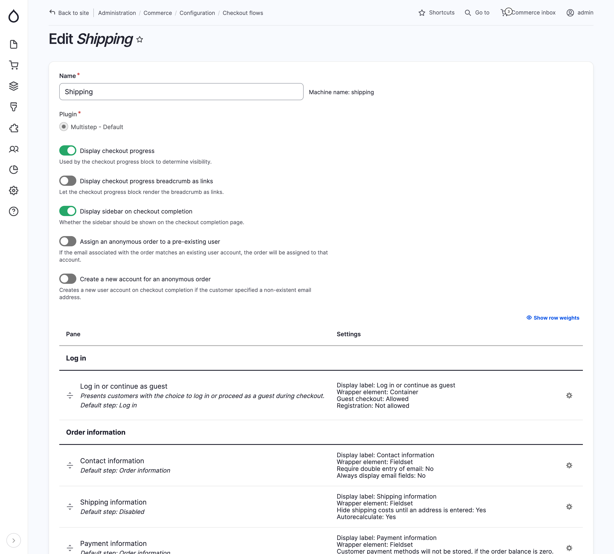
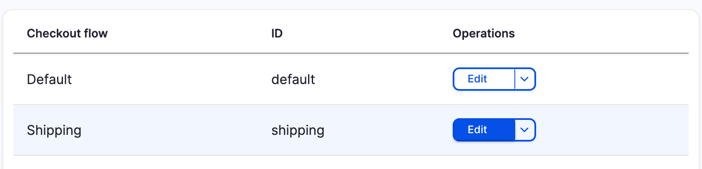
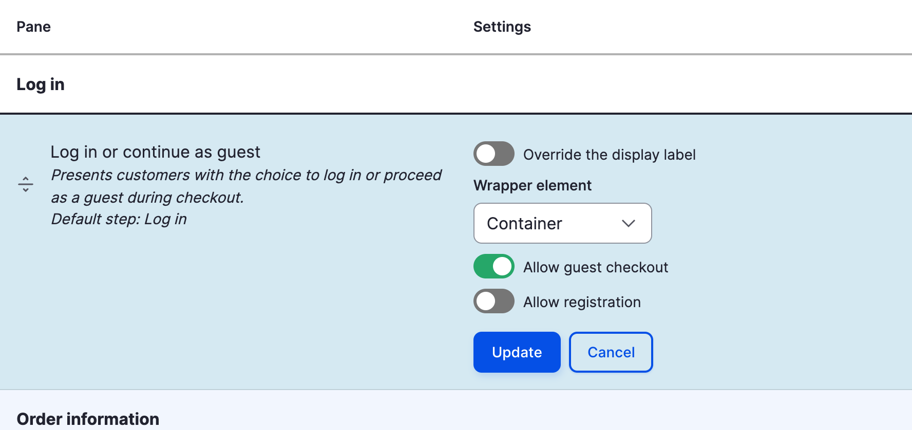
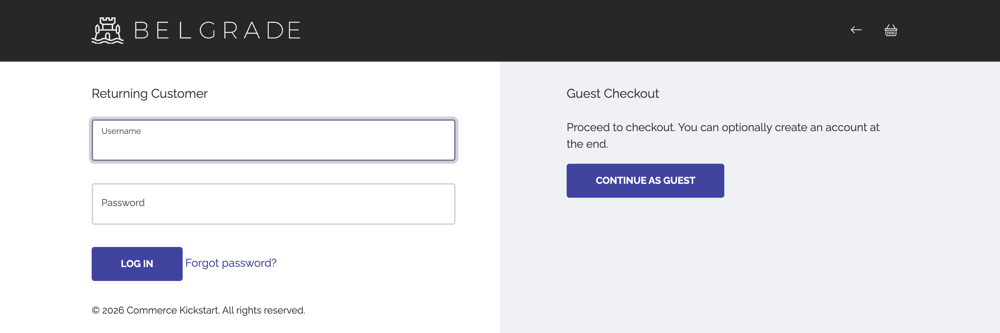
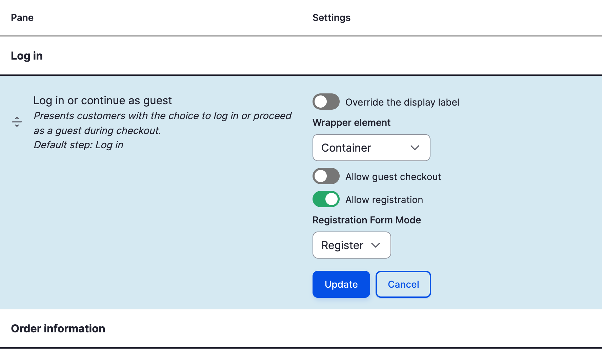
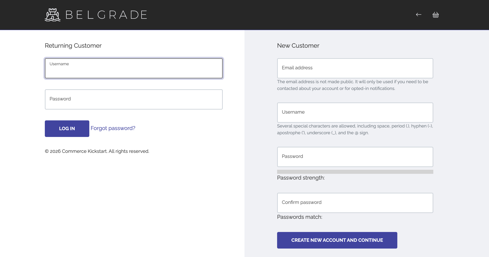
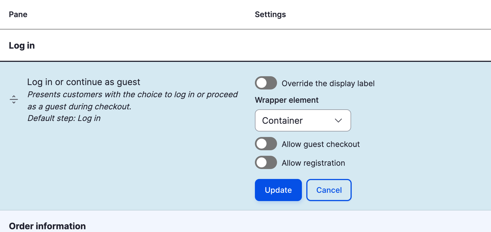
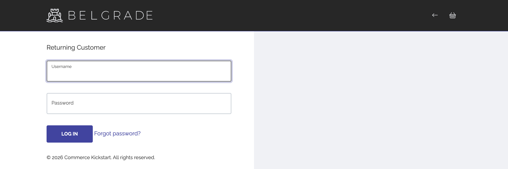
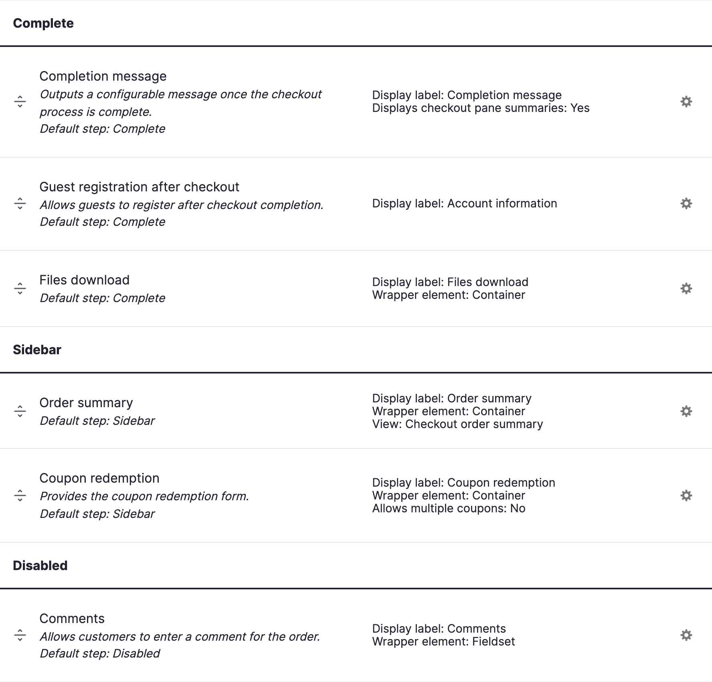

This guide is designed to help you configure and customize the checkout process for your Drupal Commerce website. Whether you're a site administrator, developer, or store owner, this documentation provides step-by-step instructions and best practices for creating a seamless and secure checkout experience.

## Configure checkout

### Checkout Flows

Checkout flows are managed at *Commerce > Configuration > Orders > Checkout flows* (`/admin/commerce/config/checkout-flows`). Each order type uses one checkout flow; Commerce Kickstart uses the **Shipping** flow.

Drupal Commerce comes with a drag-and-drop checkout form builder that lets you decide what information you need to collect from or display to customers during the checkout process. It supports single and multipage checkout depending on your requirements and can be easily extended with new components through the use of contributed or custom modules.

Above the panes, toggles control whether the checkout progress is displayed (and whether its steps are links), whether the sidebar is displayed on the completion page, and what happens to anonymous orders: assign them to an existing account with the same email address, or create a new account on checkout completion.

Panes are grouped by step. Drag a pane to another step, or to **Disabled** to remove it, and click the cog icon to configure it:

* Log in - offers customers the choice to log in, continue as a guest or register.
* Order information - the initial form used to collect order details: contact, shipping and payment information.
* Review - a review of all the order details before payment.
* Payment - submits the payment to the payment gateway. Its **Transaction mode** is either *Authorize and capture* or *Authorize only*.
* Complete - the final page, showing the checkout completion message and, for guests, the registration form.
* Sidebar - shown next to every step: the order summary and the coupon redemption form.
* Disabled - panes that are not used, such as **Comments**.

### Order information

Contains **Contact information**, **Shipping information** (with Commerce Shipping) and **Payment information**.

**Contact information** is only visible for anonymous users, allowing them to specify an e-mail address to use for their order. 
For authenticated users, the pane is not shown, because Drupal Commerce initializes the order e-mail address field to the same e-mail address on file in their user account. Turn on **Always display email fields** in the pane settings to show it to everyone.

**Payment information** checkout pane lets the customer select a payment method and enter the billing address. Authenticated customers can reuse the addresses saved in their address book.

### Review

This checkout pane displays a full summary of the order details, including data from any other checkout pane on the form that exposes it to this pane. It will include by default the cart contents again, the user's account information, and the billing address. Other checkout panes may or may not expose data to this pane, and any that does may be directed to the relevant checkbox on the pane's configuration form.

### Payment

The **Payment process** pane submits the payment to the payment gateway selected in the **Payment information** pane. Off-site gateways redirect the customer to the gateway from this step.

### Completion message

This checkout pane displays a simple checkout completion message that links to the order details page in the user's account. Even anonymous users will be able to view their completed orders for the duration of their current session. The checkout completion message is configurable via the pane's configuration form for single language sites, but multilingual sites will want to leave it set to the default message and translate the default string to the desired message through the translation interface.

## Controlling guest checkout

By default, your site will allow guest checkouts.
You can change this and only allow registered users to check out and/or allow users to register before they check out.
You can change this setting on a per Checkout Flow basis, so you can allow guest checkouts for some flows and not others as you need.

### How to enable / disable Guest Checkout

Visit the Commerce configuration page and go to the **Checkout Flows** section.

Click **Edit** on the Checkout Flow you want to configure.

To **Enable** Guest Registration

* Click the cog icon of the **Log in or continue as guest** pane.
* Turn on **Allow guest checkout**, click **Update** and then **Save** at the bottom of the page.

To **Disable** Guest Registration

* Click the cog icon of the **Log in or continue as guest** pane.
* Turn off **Allow guest checkout**, click **Update** and then **Save** at the bottom of the page.

Your first checkout page will then have the below sections. Its exact appearance depends on your theme; the screenshots on this page use Belgrade, the Commerce Kickstart storefront theme.

## Allow registration during checkout

You can restrict checkout to just users with accounts. You can then either completely deny checkout access to users without accounts or require them to create an account before they can check out.

You can change this setting on a per Checkout Flow basis, so you can deny guest checkouts for some flows and not others as you need.

### Enable / Disable Account Registration at Checkout

Visit the Commerce configuration page and go to the **Checkout Flows** section.

Click **Edit** on the Checkout Flow you want to configure.

To **Allow Registration at Checkout**

* Click the cog icon of the **Log in or continue as guest** pane.
* Turn off **Allow guest checkout**.
* Turn on **Allow registration**. Optionally, pick the user **Registration Form Mode** used for the registration form.
* Click **Update** and then **Save** at the bottom of the page.

Your page will look something like the below:

To **Deny Registration at Checkout**

* Click the cog icon of the **Log in or continue as guest** pane.
* Turn off **Allow guest checkout**.
* Turn off **Allow registration**.
* Click **Update** and then **Save** at the bottom of the page.

Your page will look something like the below.

### Allow guests to create an account during the checkout process

To give your customers the ease of creating an account at the end of their checkout, the **Guest registration after checkout** pane must be in the "Complete" step of your checkout flow. It is there by default.

To create the account automatically instead, without asking the customer, turn on **Create a new account for an anonymous order** at the top of the checkout flow form.

#### Enable / Disable Account Registration at Checkout
You need to enable / disable registration for each Checkout Flow you are using.

Visit the Commerce configuration page and go to the **Checkout Flows** section.

Click **Edit** on the Checkout Flow you want to configure.

To **Enable** Guest Registration

* Locate the "Disabled" section, drag the **Guest registration after checkout** pane into the "Complete" section and click **Save**.

To **Disable** Guest Registration

* Locate the "Complete" section, drag the **Guest registration after checkout** pane into the "Disabled" section and click **Save**.

