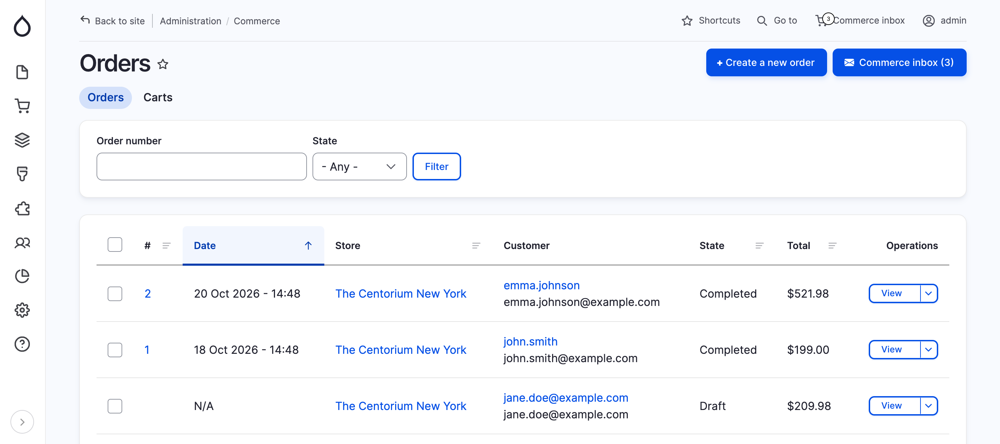
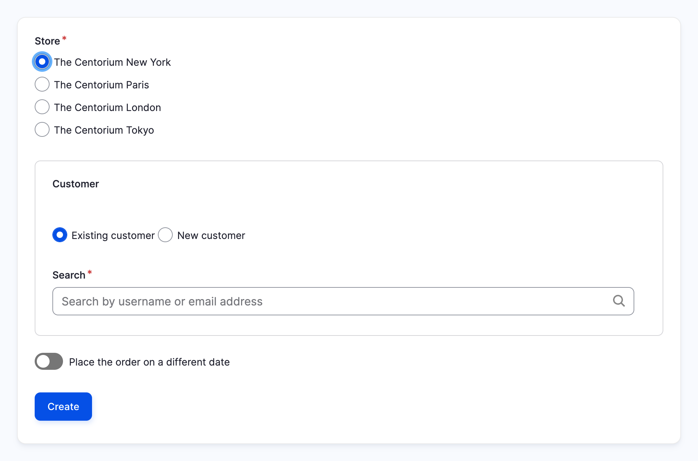
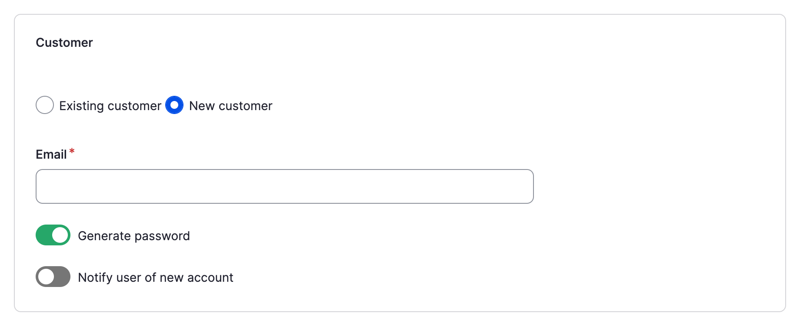
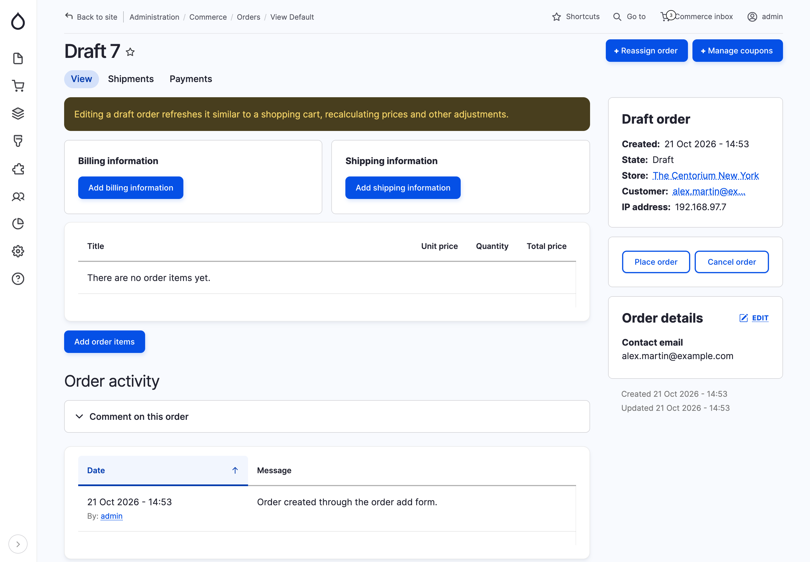
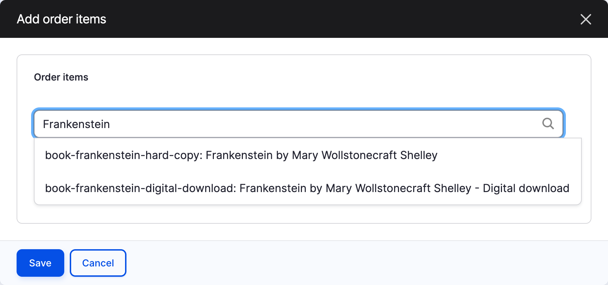
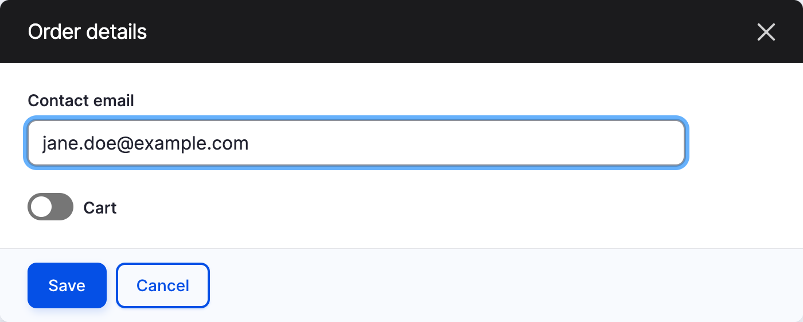
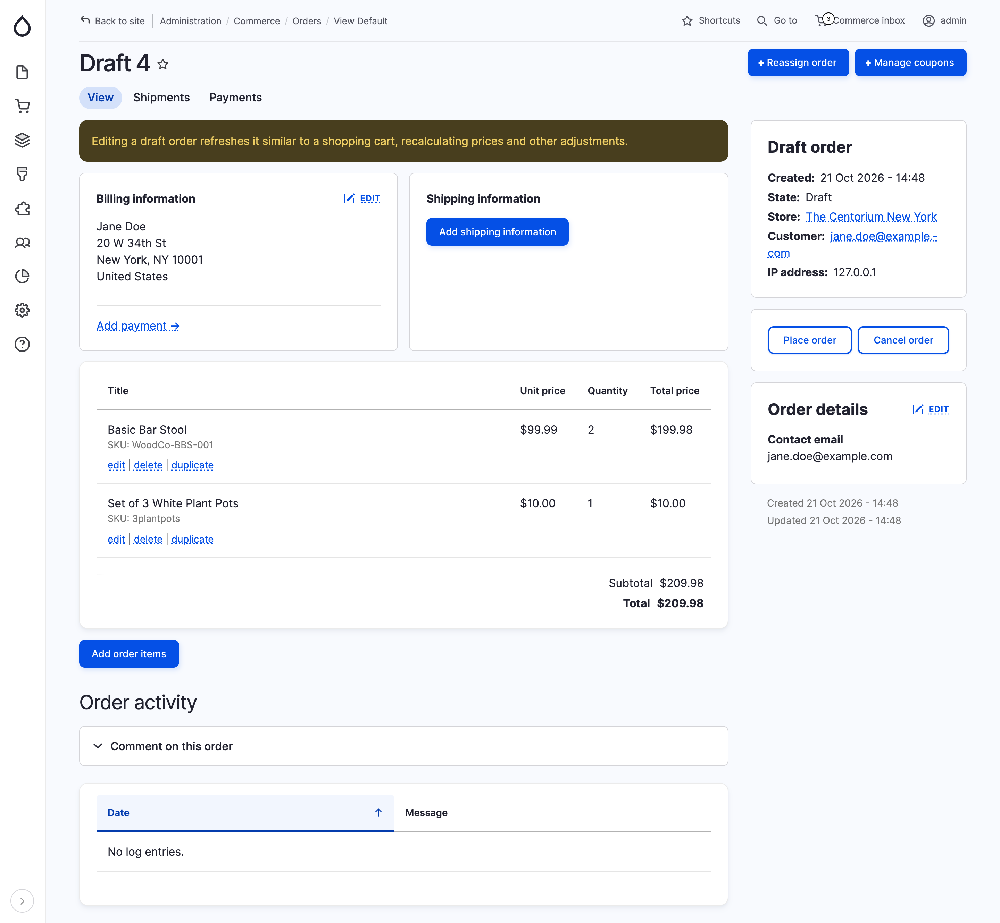
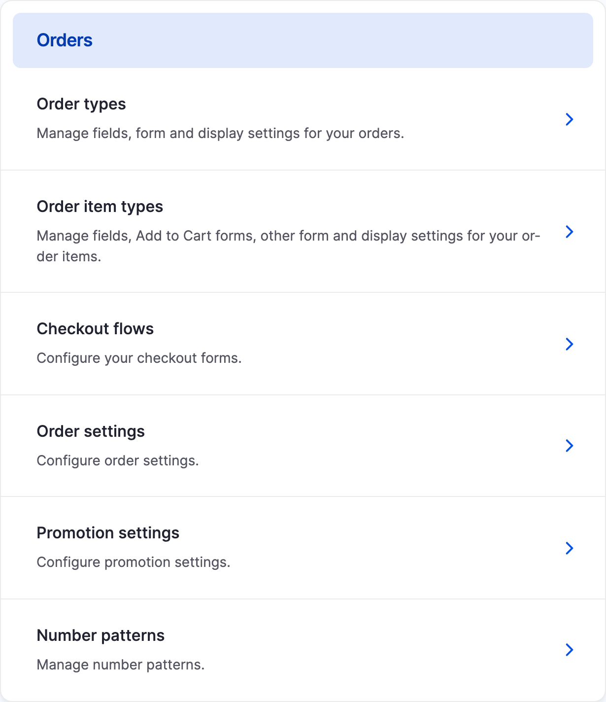
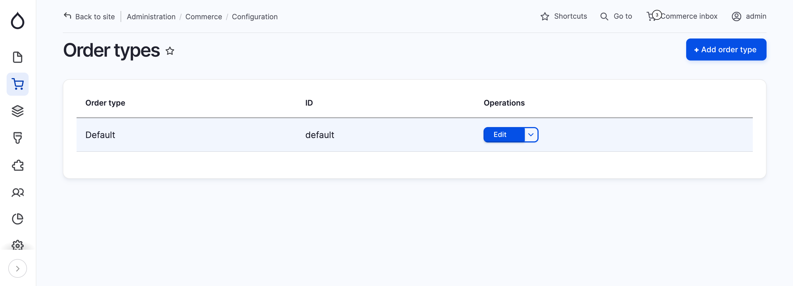
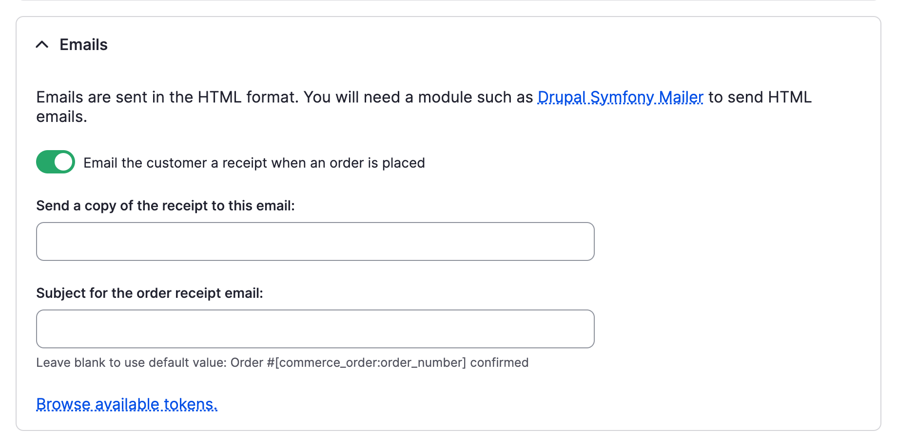

## Create an order

Orders can be created for customers in the administrative areas. This can be done by going to the **Orders** management page from the **Commerce** page from the administrative toolbar. Click on **Create a new order**.

When creating an order you select the store it is for and specify a customer. To record an order that was placed earlier, for example over the phone, turn on **Place the order on a different date** and pick the date.

Instead of re-using a customer, a new one can be created from an email address. A password is generated, unless you turn off **Generate password**, and the customer can be notified of their new account.

Click **Create**. The order is created as a draft, and you are taken to its page, where it can be completed one section at a time:

- **Billing information**: add the customer's billing address. Once it is set, the **Add payment** link takes you to the order's **Payments** tab, to record a payment.
- **Shipping information** (with Commerce Shipping): add the shipping address and choose a shipping method.
- **Add order items**: add the products the customer is purchasing.
- **Order details**: change the contact email, or mark the order as a cart. By marking the order as a cart, the customer will be able to review the cart and go through the checkout with it.

The **Reassign order** and **Manage coupons** buttons let you change the order's customer, and apply coupons.

Click **Add order items** to open the order items dialog. Search for a product variation by title or SKU, and click **Next**. Set the quantity, and optionally turn on **Override the unit price** to set a custom price, then click **Add**. Repeat for each product, then click **Save**.

The order details are edited in a dialog as well, from the **Edit** link of the **Order details** sidebar section:

Once added, each order item can be edited, deleted or duplicated from the order items list. When the order is complete, click **Place order**.

Prices, promotions and taxes are calculated automatically when the order is refreshed. To change what the customer pays, edit the order items, or apply a promotion or coupon to the order.

## Viewing carts
Carts are created whenever a customer submits an Add to Cart form or when an admin creates an order via the _Create a new order_ button on the _Orders_ page and turns on _Cart_ in its _Order details_. Carts have an order ID but no order number, as those are not generated until the order is placed. You can view the current carts in your store by navigating to the Commerce > Orders page and clicking the _Carts_ tab. From the _Carts_ tab you can view, edit, reassign, add payment information to, or delete a cart using the dropdown operations menu based on your account's permissions. 

When a customer completes checkout or an admin places the order, the cart option is toggled off and the order ID remains the same but an order number is generated that follows the number pattern setup for the order type. Until checkout completion or order placement, carts are in a unique order status called _Draft_ that allows the order items to be periodically refreshed, updating the pricing and availability of the products in the cart. Once a cart is placed and moves out of the draft status, the order will no longer be periodically refreshed. 

### Purging abandoned carts

Periodically purging abandoned carts will minimize junk carts in the database and alleviate performance issues caused by hundreds of thousands of stale carts hanging around indefinitely. You can set the system to automatically purge abandoned carts after a certain period of time by enabling the _Delete abandoned carts_ option on the order type configuration screen. The setting needs to be enabled for each order type, and the time period should be configured. The default when enabling this option is 30 days. Carts that have not been updated within the configured time frame will be deleted when the cron job runs. Note that the configured time frame is a rolling interval, meaning the counter is reset whenever the cart is modified.

You can also manually purge carts en masse via the bulk operation available to you on the Cart page in the admin interface.

## View orders, find specific ones

All placed orders are listed at *Commerce > Orders* (`/admin/commerce/orders`). Filter the list by **order number**, **type** or **state**. Click an order to view it: the order page shows its items, totals, customer and billing information, payments, and the buttons to move it through its workflow.

Carts (orders that haven't been placed yet) are listed separately, on the *Carts* tab.

## Manage an order

### Setting the order number pattern

In Drupal Commerce, you have the flexibility to tailor order numbers to your business’s requirements. Number patterns are configurable per order type and can be shared or set to be unique for each store.

To begin, navigate to Commerce > Configuration > Orders > Number patterns to create a number pattern. On this page, you can establish new patterns, each requiring a unique name. The number patterns form offers several configuration options, including regeneration settings, what number to start from, and whether numbers are shared between stores.

The strength of number patterns lies in the versatility provided as to how the numbers are generated. You can incorporate a blend of custom strings and tokens, allowing for prefixed or suffixed numbers based on fixed strings or structured data from your site. This gives you the ability to brand your order numbers and segment your orders based on business needs without writing custom code.

After configuring your number pattern, it’s time to make use of it on one or more order types. Proceed to Commerce > Configuration > Orders > Order types. Here, edit the order type that requires the new number pattern. Within the order type’s edit page, select your previously created number pattern from the dropdown menu then save the form. New orders will now make use of your custom number pattern.

### Order workflows

Every order follows a **workflow**: a set of **states** the order can be in, and the **transitions** that move it from one state to another. Orders start in the *Draft* state while they are carts. When the customer completes checkout (or an administrator places the order), the *Place order* transition moves the order out of draft.

Commerce provides four workflows:

| Workflow | States after the order is placed | Use it when |
|---|---|---|
| **Default** | Completed | There's nothing to do after the order is placed, for example digital products delivered immediately. |
| **Default, with validation** | Validation → Completed | Someone must check orders before accepting them, for example to review fraud or stock. |
| **Fulfillment** | Fulfillment → Completed | Orders must be fulfilled, for example shipped, before they are complete. |
| **Fulfillment, with validation** | Validation → Fulfillment → Completed | Orders must be checked, then fulfilled. |

In every workflow, orders that aren't completed can be moved to *Canceled* with the *Cancel order* transition.

The workflow is set per order type. To change it, go to *Commerce > Configuration > Orders > Order types*, edit the order type and choose a **Workflow**. It applies to all orders of that type. Developers can create their own workflows; see [Order workflows](../developer-guide/orders/workflows.md).

### Processing an order

Orders are processed from the order page: the available transitions are shown as buttons, such as *Validate order*, *Fulfill order* or *Cancel order*.

For example, with the **Fulfillment, with validation** workflow:

1. The customer completes checkout. The order is placed and moves to *Validation*.
2. A store manager reviews the order: they check that the payment isn't fraudulent and has been captured (see [Payment administration](payment/payment-administration.md)), and that the products are in stock. They then click *Validate order*, which moves the order to *Fulfillment*.
3. Once the order is shipped, they click *Fulfill order*, and the order is *Completed*.

If there's a problem, for example the payment is declined or the products are out of stock, they click *Cancel order* instead.

## Receipt emails

These settings are managed on an Order Type basis so that you can have different settings for different types of orders and manage order notifications in a granular way.

### Enable / Disable Customer Order Receipts & Store Notification Emails

Visit the Commerce configuration page and go to the Order types page in the Orders section.

Click on **Edit** on the order type you wish to configure

Locate the **Emails** section

 - Check / uncheck the **Email the customer a receipt when an order is placed** box.
 - Enter the store notification email address into the **Send a copy of the receipt to this email:** field. You can enter multiple comma separated addresses into this field eg "one@example.com, two@example.com, three@example.com"

### Editing / Translating the Email Text

Use the template file located in `/commerce/modules/order/templates/commerce-order-receipt.html.twig`.

You can copy this file to your theme and then edit the text as desired. You can also use the file as a translation reference when searching for strings to translate in the user interface translation UI.

