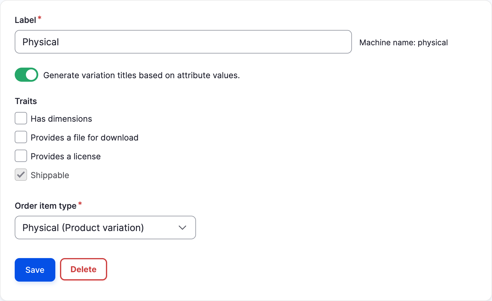

Shipping is provided by the [Commerce Shipping](https://www.drupal.org/project/commerce_shipping) module. It includes flat rate shipping methods (per order and per item); for rates calculated by carriers such as FedEx or UPS, you add a module for your carrier. See the [list of available shipping methods](../developer-guide/shipping/getting-started.md#available-shipping-methods).

## Core concepts

- **Shipment**: a group of order items shipped together to one address. An order can have one or several shipments, each with its own shipping method, cost and tracking code.
- **Shipping method**: a way to ship, such as "Standard" or "Express", with a rate calculated by its plugin (flat rate or carrier). Customers choose one for each shipment at checkout.
- **Package type**: the box or envelope a shipment is packed in, with its dimensions and weight. Carriers use it to calculate rates.
- **Packer**: the logic that splits an order into shipments. By default, all shippable items of an order go into a single shipment.

## Before you begin

Install and enable Commerce Shipping:

```bash
composer require drupal/commerce_shipping
drush en commerce_shipping
```

To use a carrier, also install its module and follow its instructions. For example, for FedEx:

```bash
composer require drupal/commerce_fedex
drush en commerce_fedex
```

## Enable shipping for products

Set your product variation types as shippable: go to *Commerce > Configuration > Products > Product variation types* (`/admin/commerce/config/product-variation-types`), edit each variation type you ship and check the **Shippable** trait. This adds a **Weight** field to its variations. If your carrier needs them, also check **Has dimensions**.



Then edit your order type, at *Commerce > Configuration > Orders > Order types*:

- Check **Enable shipping for this order type**, and choose a **Shipment type**.
- Choose a checkout flow that includes the *Shipping information* pane. Commerce Shipping provides a *Shipping* checkout flow you can start from; add your payment panes to it.
- Consider using one of the *Fulfillment* workflows, so that orders wait for their shipments to be sent before being completed. See [Order workflows](orders.md#order-workflows).

The *Shipping information* checkout pane has two settings:

- **Hide shipping costs until an address is entered**.
- **Auto recalculate shipping costs when the shipping address changes**.

## Configure shipping methods

Shipping methods are managed at *Commerce > Configuration > Shipping > Shipping methods* (`/admin/commerce/shipping-methods`). Click *Add shipping method*, then fill in:

- **Name**: the administrative name.
- **Plugin**: *Flat rate*, *Flat rate per item*, or a carrier's plugin.
- The plugin's settings. For flat rates: the **Rate label** shown to customers, an optional **Rate description**, and the **Rate amount**. Carrier plugins have their account credentials and **Shipping services** instead.
- **Default package type**, used when the packer doesn't choose one.
- **Shipment workflow**.
- **Stores**: where the method is available.
- **Conditions**: limit when the method is offered, for example with the *Shipping address* (to a [zone](../developer-guide/customers/addresses.md#zones-and-territories)), *Shipment weight* or *Shipment quantity* conditions, or any order condition.
- **Enabled**.

At checkout, customers see the methods whose conditions pass, in the order of the shipping method list.

### Using FedEx, USPS, UPS

Carrier modules provide shipping method plugins that request live rates from the carrier's API. Install the module for your carrier, add a shipping method using its plugin and enter your carrier account credentials. Carriers calculate rates from the shipment's weight, package type and addresses, so make sure your variations have a weight, and dimensions if required.

### Adding custom shipping rates

For rates that flat rates can't express, for example a rate table by weight or by zone, you can:

- Add several flat rate shipping methods, each limited by conditions. For example, a "Standard" method at $5 for shipments under 2 kg, and another at $10 for heavier shipments.
- Write a shipping method plugin; see the [Shipping developer guide](../developer-guide/shipping/getting-started.md#create-a-shipping-method).

To offer free or discounted shipping, create a promotion with the *Fixed amount off the shipment amount* or *Percentage off the shipment amount* offer. See [Promotions](promotions.md).

## Managing shipments

Shipments are created during checkout, when the customer chooses a shipping method, and listed on the order's *Shipments* tab. You can also add, edit or remove shipments there, and enter each shipment's **Tracking code**.

Each shipment follows a workflow: **Draft** → **Ready** → **Shipped**, or **Canceled**. Shipments follow their order:

- When the order is placed (or validated, with a validation workflow), its shipments are finalized and become *Ready*.
- When the order is fulfilled (*Fulfill order*), its shipments become *Shipped*.
- When the order is canceled, its shipments are canceled.
