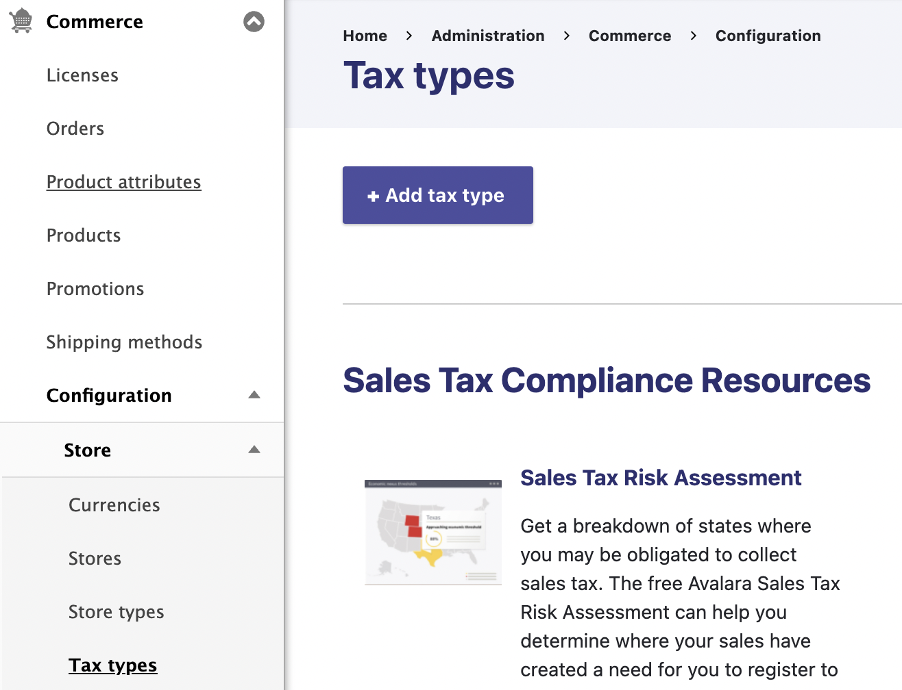
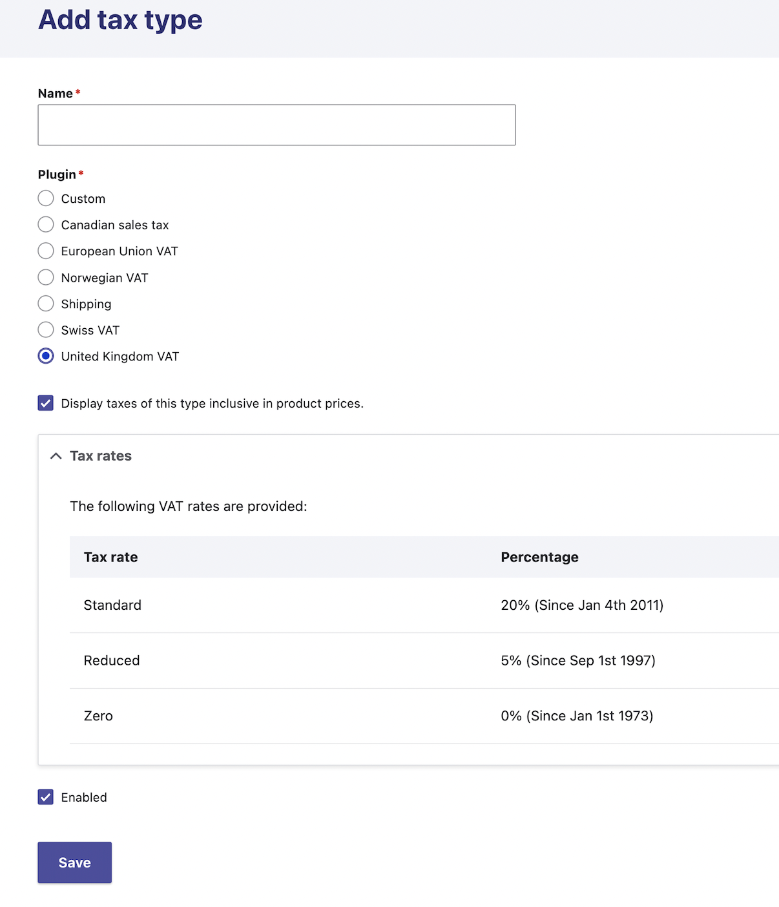
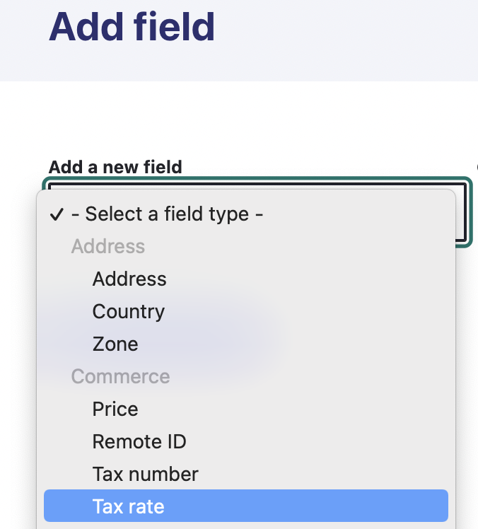
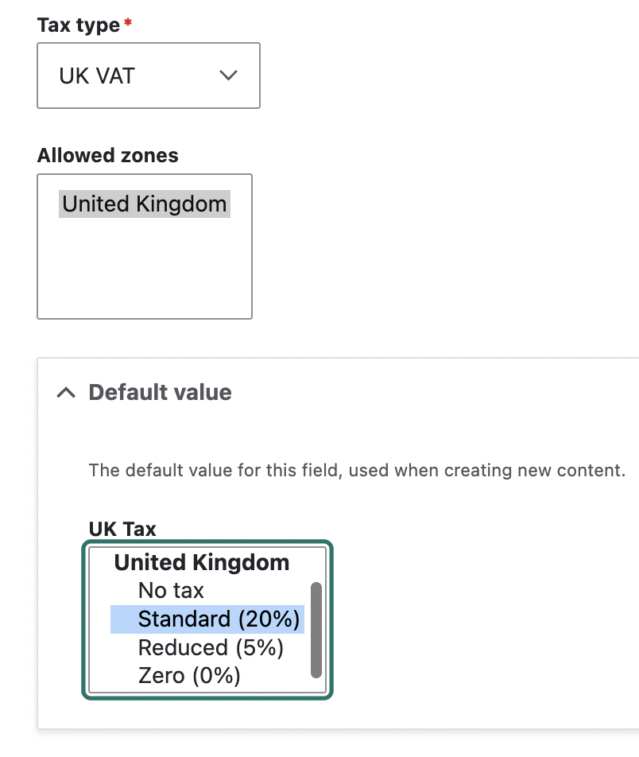
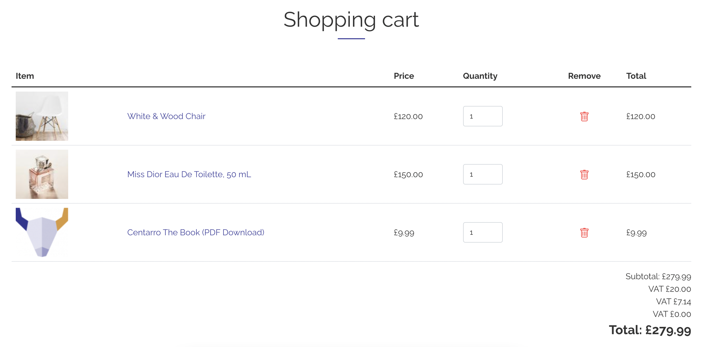

Taxes are provided by the Commerce Tax module (`commerce_tax`), part of Commerce Core. Taxes are calculated for each order item, based on the store, the customer's address and the type of product, and added to the order as tax adjustments.

## Before you begin

Each store has its own tax settings, in the *Tax settings* section of the store form (*Commerce > Configuration > Store > Stores*):

- **Prices are entered with taxes included**: check this if your product prices already include tax, which is common for VAT. Commerce then calculates the tax included in the price instead of adding it on top.
- **Tax registrations**: the countries where your store collects tax. **A tax type only applies to orders from a store registered in one of its countries, including the store's own country.** For example, a French store must list France to charge French VAT, and also needs to list Germany if it's registered to collect German VAT.

The kind of product also matters. Each order item type has a **Taxable type** setting (*Commerce > Configuration > Orders > Order item types*): physical goods (the default), digital goods, services, events, or non-taxable. For example, EU VAT treats digital goods differently from physical goods.

## Tax types

Tax types are managed at *Commerce > Configuration > Store > Tax types* (`/admin/commerce/config/tax-types`). Click *Add tax type*, then choose a plugin. Commerce Core provides:

| Tax type | Rates |
|---|---|
| **European Union VAT** | Rates for every EU member state, plus their special territories. |
| **United Kingdom VAT** | UK VAT rates. |
| **Swiss VAT** | Rates for Switzerland and Liechtenstein, plus the Büsingen and Campione enclaves. |
| **Norwegian VAT** | Norwegian VAT rates. |
| **Canadian sales tax** | GST, HST and PST, by province. |
| **Custom** | Your own zones and rates. |

The built-in rates are maintained in Commerce Core, so you only need to keep Commerce up to date. Tax types share a few settings:

- **Display taxes of this type inclusive in product prices**: show product prices with this tax included.
- **Display tax rate in the adjustment label**: show the percentage next to the tax name, for example "VAT (20%)".

### European Union VAT

The EU VAT tax type picks the rate based on where the store and customer are, and on the order item's taxable type:

- **Physical goods** are taxed at the rate of the store's country, unless the store is also registered in the customer's country, in which case the customer's country rate is used.
- **Digital goods** are taxed at the rate of the customer's country.
- **Business customers (B2B)**: when the customer enters a valid EU VAT number in another EU country, the order uses the intra-community (zero) rate. The VAT number is collected by the *Tax number* field on the customer's billing profile.
- **Non-taxable** order items are never taxed.

A store outside the EU only charges EU VAT on digital goods, and only if it's registered for EU VAT in its tax registrations.

### Swiss and Norwegian VAT

Add the tax type, and make sure the store's tax registrations include Switzerland or Norway.

### Canadian GST

The Canadian sales tax type applies to customers with a Canadian address, and adds GST, HST and PST based on their province. The store's tax registrations must include Canada.

### US sales tax

US sales tax rates vary by state, county and city, and change often, so Commerce Core doesn't include them. Use a tax service integration instead, such as [Commerce AvaTax](https://www.drupal.org/project/commerce_avatax) or [Commerce TaxJar](https://www.drupal.org/project/commerce_taxjar). For a few simple rates, you can also use a [custom tax type](#custom-tax-rules).

### Custom tax rules

The **Custom** tax type lets you define your own taxes:

1. Choose a **Display label**, used to identify the tax in order summaries ("Tax", "VAT", "GST" and so on).
2. Choose whether to **Round tax at the order item level**. VAT-style taxes are rounded per item; sales taxes aren't.
3. Define the **rates**, each with a name and a percentage.
4. Define the **territories** the tax applies to: countries, optionally narrowed down to regions or postal codes.

## Per-product tax rates

By default, Commerce applies the standard rate. To pick a reduced or zero rate for some products, use the [Commerce Product Tax](https://www.drupal.org/project/commerce_product_tax) module, described below. If you need to choose the rate in code, see [Understanding resolvers](../developer-guide/core/understanding_resolvers.md).

## Commerce Product Tax

### Overview

Commerce Product Tax provides a user interface for selecting applicable tax rates on the product variation.

This module provides a `commerce_tax_rate` field type, which allows selecting a standard, reduced or no tax rate, in cases of tax-free products.

### Adding a new Tax Type

You will need to add a new tax type to your Store.

Select a tax type from the available plugin options. Then, you will see a list of the tax rates. 
Give the tax type an appropriate name and click **save**.

### Update Product Variation types

Next you will need to create a new field for your product variation(s).
Select `Tax rate` from the dropdown and give the field an appropriate label.

On the next page, you will be able to select what tax type you wish to use and the allowed zones. 
You can also set the default value to the Standard rate or a reduced/zero rate.

### Update Product Variations

You can now edit your product variations and select the applicable tax rate.
Depending on your Store settings, your tax rate will be visible on the cart page.
If you have products with different tax rates, they will be displayed on separate rows.

!!! note
    If you have multiple stores, you can add multiple tax rate fields to a product variation. For example, a product could have a UK tax rate of 20% and a ROI tax rate of 23%

!!! example "Example"

    We have a UK based Store that sells both physical and digital products.
    Most products have the standard 20% VAT tax rate. 
    Digital products are exempt and have a zero rate.
    Some products have a reduced rate of 5% VAT.

    When viewing the cart, we can see the three different levels of tax applied. 
    All prices displayed are inclusive of VAT.

    